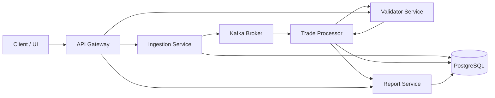

# TradeSense Technical Design Document

## 1. Project Brief

TradeSense is an event-driven trade data processing platform designed to ingest trade files, validate trade quality, persist structured trade records, and expose reporting and streaming capabilities through a unified API gateway.

The system is built as a modular Spring Boot-based microservice architecture with the following responsibilities:

- Ingestion Service: accepts uploaded trade files, stores metadata and raw records, and publishes processed events.
- Trade Processor: consumes Kafka events, normalizes trade records, stores trade state, and calls the validation service.
- Validator Service: applies business validation rules using Drools/KIE.
- Report Service: serves analytics and reporting queries over persisted trade data.
- API Gateway: exposes a single HTTP entry point and routes requests to the relevant backend services.
- Liquibase: manages database migrations and schema creation.

This design supports high-volume trade processing, rule-driven validation, auditability, and operational visibility across distributed services.

---

## 2. Architectural Overview

### 2.1 Core Design Goals

- Process trade data reliably from file ingestion to validation and reporting.
- Keep services independent while using a shared domain model.
- Enable asynchronous communication using Kafka for event distribution.
- Expose a single front door through an API gateway.
- Ensure portability with Docker and environment-based configuration.
- Support observability through metrics, tracing, and structured logging.

### 2.2 Service Layout

| Service | Primary Responsibility | Communication Pattern | Data Store |
|---|---|---|---|
| tradesense-api-gateway | API routing and external access | HTTP/REST, reactive routing | None |
| tradesense-ingestion-svc | File ingestion and raw payload capture | HTTP upload + Kafka publish | PostgreSQL |
| tradesense-trade-processor | Event consumption and trade processing | Kafka consumer + HTTP validation call | PostgreSQL |
| tradesense-validator-svc | Trade validation logic | HTTP REST | In-memory Drools rules |
| tradesense-report-svc | Query/report generation | HTTP/REST | PostgreSQL |
| tradesense-liquibase | Schema versioning and migration | JDBC | PostgreSQL |

---

## 3. System Interaction and Flow

### 3.1 End-to-End Flow

1. A user uploads a trade file through the ingestion service.
2. The ingestion service records a batch and raw trade records in PostgreSQL.
3. The ingestion layer processes and publishes trade events to Kafka.
4. Trade processor consumes Kafka events and persists trade-domain objects.
5. The trade processor invokes the validator service over HTTP.
6. The validator applies Drools rules and returns validation results.
7. Validated trade information is stored and exposed via reports and API queries.
8. The API gateway consolidates access for UI and client applications.

### 3.2 Mermaid Flow Diagram

---

## 4. Technical Design Principles

### 4.1 Communication Model

TradeSense uses a hybrid integration model:

- HTTP/REST: used for sync service-to-service communication, especially between the gateway and backend services, and between the trade processor and validator service.
- Kafka: used for asynchronous event-driven propagation between ingestion and processing stages.
- JDBC: used to persist state and manage schema migration with Liquibase.
- W3C Trace Context: used for distributed tracing across service boundaries.

### 4.2 Protocols and Standards

| Layer | Technology | Purpose |
|---|---|---|
| API access | HTTP/REST | Gateway and service APIs |
| Internal service call | Spring WebFlux + Reactor | Gateway and routed requests |
| Event transport | Kafka | Asynchronous message distribution |
| Persistence | PostgreSQL + JPA/Hibernate | Relational data storage |
| Schema migration | Liquibase | Version-controlled migrations |
| Rule engine | Drools / KIE | Validation decision logic |
| Observability | Micrometer + tracing | Metrics and distributed traces |

### 4.3 Design Patterns

- Layered Architecture: domain, application, adapter, infrastructure separation.
- Event-Driven Architecture: Kafka-driven processing after file ingestion.
- Gateway Pattern: single public endpoint before internal microservices.
- Repository Pattern: JPA repositories for relational persistence.
- Strategy/Rule Engine Pattern: Drools validates trade rules in a configurable way.
- Async Processing Pattern: batch and scheduling support for ingestion and async flows.

---

## 5. Data Model and Table Design

The database is designed around ingestion, trade lifecycle, validation, and instrumentation tracking.

### 5.1 Core Tables

| Table Name | Significance | Key Columns |
|---|---|---|
| ingestion_batch | Tracks each uploaded trade file batch and its processing state. | batch_id, batch_name, source_type, file_name, file_checksum, status, total_records, processed_records, valid_records, invalid_records |
| ingestion_record | Captures each raw source record inside a batch. | record_id, batch_id, source_type, source_system, raw_payload, ingestion_status, received_at |
| trade | Represents the canonical trade after ingestion and processing. | id, ingestion_record_id, booking_system, trade_id, source_type, trade_status |
| trade_instrumentation | Stores trade instrument metadata such as quantity and price. | id, trade_id, instrument_id, quantity, trade_price, trade_timestamp |
| trade_validation | Stores outcome of rule-based validation checks. | id, trade_id, validation_status, error_code, error_message, rule_name, rule_version |

### 5.2 Table Significance by Domain

#### ingestion_batch
This is the top-level container for every file upload. It holds file metadata, batch lifecycle status, and counters that summarize processing progress. It is the primary audit object for ingestion operations.

#### ingestion_record
Each row in a file becomes a raw payload stored here. This table preserves source fidelity for traceability and replay support. It ties a record back to its source batch and stores the original JSON payload.

#### trade
This table is the business truth for a processed trade. It stores the canonical identifier, booking system, trade id, and current status. This is the entity used downstream by validating and reporting services.

#### trade_instrumentation
This table holds financial details associated with a trade, such as instrument identifier, traded quantity, price, and timestamp. It supports analysis and downstream pricing calculations.

#### trade_validation
This table captures validation results from the rules engine. It records whether the trade passed or failed validation and, if failed, the associated error code, message, and rule name.

### 5.3 Schema Design Notes

- UUID primary keys are used for distributed-safe identity management.
- PostgreSQL JSONB is used for raw ingestion payloads to retain source fidelity.
- Timestamptz is used to preserve timezone correctness and audit consistency.
- Foreign key constraints enforce data integrity between batch, record, trade, and validation tables.
- Check constraints restrict valid enums and supported states.

---

## 6. Validation Architecture

Trade validation uses the Drools/KIE engine to evaluate the business rules applied to trades.

### 6.1 Validation Flow

1. Trade processor prepares a validation request.
2. Validator service receives HTTP request.
3. KIE classpath container loads rules from project resources.
4. Rules evaluate trade status, booking system, instrument conditions, and related validation facts.
5. Validation result is returned with status, rule names, and errors.

### 6.2 Why Drools

Drools is appropriate because:

- rules can be updated without changing Java code,
- validation logic is business-driven and expressive,
- rule definitions remain maintainable and testable,
- trade checks can be extended as business rules evolve.

---

## 7. Service-to-Service Communication Detail

### 7.1 Gateway to Services

The API gateway routes requests based on path configuration and exposes external endpoints such as:

- /api/v1/trades/**
- /api/v1/validation/**
- /api/reports/**

This reduces the client’s dependency on internal service topology and centralizes routing, CORS, and access control.

### 7.2 Processor to Validator

The trade processor calls the validator service over HTTP. This ensures validation is separated from decision-making and the rule engine remains isolated behind a focused validation boundary.

### 7.3 Ingestion to Kafka

After raw trade records complete intake, messages are published to a Kafka topic to support asynchronous consumption. This decouples ingestion from downstream processing and allows event replay and scaling.

---

## 8. Deployment and Runtime Considerations

### 8.1 Runtime Components

The solution is deployed with Docker Compose and includes:

- PostgreSQL database
- Kafka cluster and supporting tools
- Liquibase migration service
- Ingestion service
- Trade processor
- Validator service
- Report service
- API gateway

### 8.2 Deployment Traits

- Services are containerized with a single application image base.
- Environment variables control ports, DB URLs, and Kafka bootstrap configuration.
- Docker networking enables inter-service discovery in a local environment.
- Containers are orchestrated with dependency-based startup sequencing.

---

## 9. Observability and Resilience

TradeSense includes operational support patterns:

- Micrometer metrics for service health and runtime behavior
- W3C trace propagation for distributed transaction visibility
- Health endpoints exposed for operational monitoring
- Retry and circuit breaker configuration around external validation calls
- Log correlation using trace and span identifiers

These patterns help identify bottlenecks, validate service health, and trace requests through asynchronous flows.

---

## 10. Non-Functional Requirements

### Performance
- Batch-based ingestion supports large file processing.
- Kafka decouples heavy processing from upload latency.
- JPA repositories and indexing support efficient report queries.

### Scalability
- Services can scale independently.
- Kafka allows horizontal expansion of processors.
- Gateway supports multiple service instances through load balancing.

### Reliability
- Data is persisted before asynchronous processing.
- Validation result records provide forensic clarity.
- Database constraints ensure referential integrity.

### Maintainability
- Clear module boundaries by domain responsibility.
- Shared common model package reduces duplication.
- Liquibase keeps schema change history under version control.

---

## 11. Design Summary

TradeSense is designed as a modular, event-driven trade processing platform that balances reliability, traceability, and business rule flexibility. Its architecture combines REST APIs, Kafka messaging, a Drools rule engine, and PostgreSQL persistence to deliver a production-oriented system for trade ingestion, validation, and reporting.

The key technical strengths are:

- decoupled asynchronous processing,
- centralized API access,
- strong transactional and audit data model,
- extensible validation engine,
- operational observability,
- and modular microservice-based deployment.

---

## 12. Short Table Reference

| Area | Technology | Why It Matters |
|---|---|---|
| Service Framework | Spring Boot 3/4 | Rapid modular service development |
| Gateway | Spring Cloud Gateway | Unified external access |
| Messaging | Kafka | Real-time event decoupling |
| Persistence | PostgreSQL + JPA | Strong transactional data storage |
| Validation | Drools/KIE | Rule-based decision engine |
| Database Migration | Liquibase | Controlled schema evolution |
| Observability | Micrometer/Tracing | Service-level visibility |
| Deployment | Docker Compose | Local and environment portability |

This document is intended to provide a clear technical foundation for understanding the TradeSense architecture, domain model, communication patterns, and operational design.

